<!-- The logo, the screenshots and the activity charts are each in a link whose address ends in GitHub's marker for a theme
     (#gh-light-mode-only, #gh-dark-mode-only), so GitHub shows the one for the theme chosen on GitHub. -->
<p align="center">
  <a href="docs/brand/sedjem-logo-colour.svg#gh-light-mode-only"></a>
  <a href="docs/brand/sedjem-logo-colour-dark.svg#gh-dark-mode-only"></a>
</p>

<p align="center">
  Transcripts of Egyptian Arabic–English meetings, made on your computer, each speaker told apart by voice.
</p>

<h3 align="center"><a href="https://github.com/MohammedEl-sayedAhmed/sedjem/releases/latest">Download for Windows or Linux</a></h3>

<p align="center">
  <a href="#install">Install from source</a>
  · <a href="https://mohammedel-sayedahmed.github.io/sedjem/">Website</a>
</p>

<p align="center">
  <a href="https://github.com/MohammedEl-sayedAhmed/sedjem/tree/stats#readme"></a>
  <a href="https://github.com/MohammedEl-sayedAhmed/sedjem/stargazers"></a>
  <a href="docs/03-results.md"></a>
  <a href="docs/03-results.md"></a>
</p>

<p align="center">
  <a href="docs/video/sedjem-tech.mp4">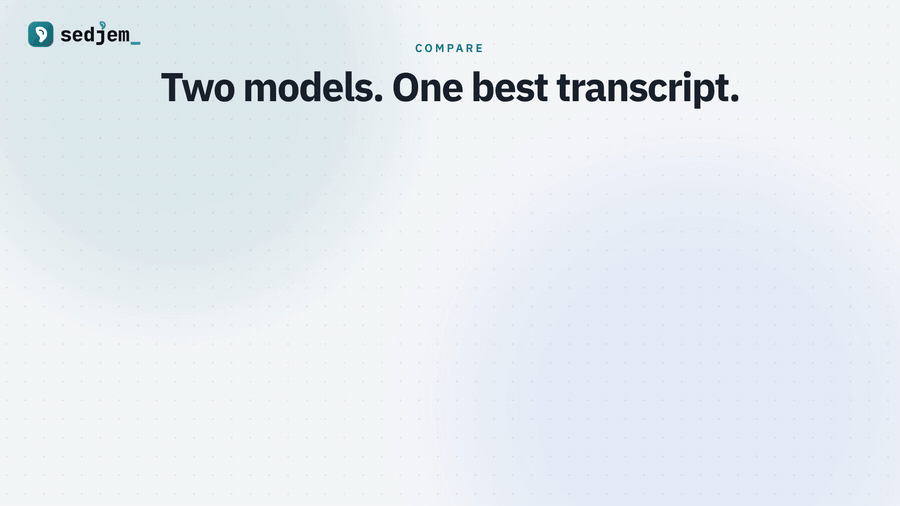</a>
  <br><sub><a href="docs/video/sedjem-tech.mp4">Watch the 60-second video</a></sub>
</p>

Egyptian tech teams talk in Arabic sentences full of English words: *deadline*, *sprint*,
*merge request*. Many speech-to-text models handle this badly. Some write the English words in
Arabic letters (on the Egyptian test set, several kept only 8–25% of them in Latin script), others
turn Egyptian speech into formal Arabic. Sedjem (the ancient Egyptian word for "to hear") runs models
that were measured to do better, labels who said what by listening to their voices, and keeps the
recording on your machine unless you choose a hosted service.

## What it does

- Transcribes recordings, videos and YouTube links with three local models chosen for Egyptian Arabic–English.
- Labels each speaker by voice, and plays the audio in step with the text.
- Combines two models' transcripts line by line, and keeps every version (below).
- Exports text, SRT, WebVTT, Markdown or JSON, and lets assistants such as Claude read your transcripts over MCP.
- Can use one of nine hosted services with your own API key, only after you allow each upload.

<p align="center">
  <a href="site/captures/reading-wide-light.png#gh-light-mode-only">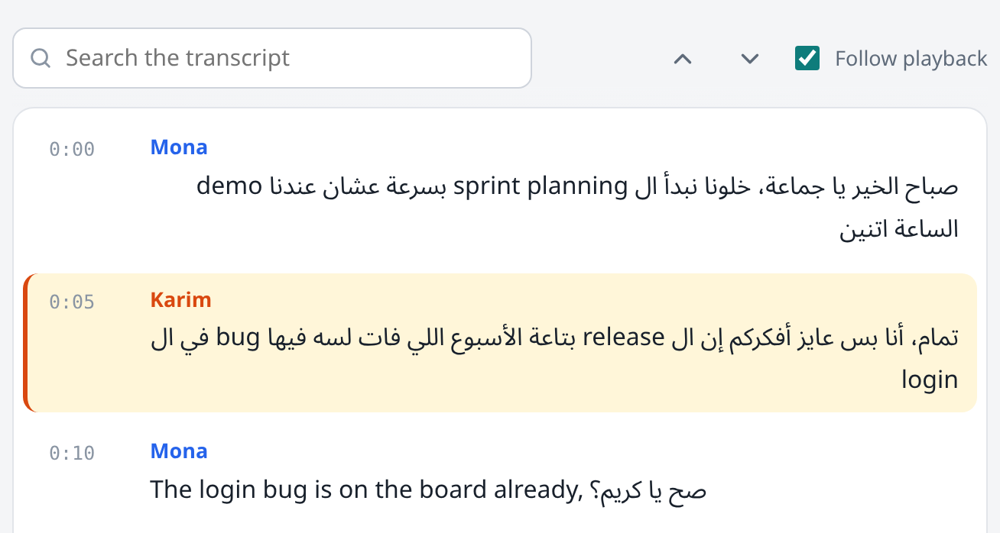</a>
  <a href="site/captures/reading-wide-dark.png#gh-dark-mode-only">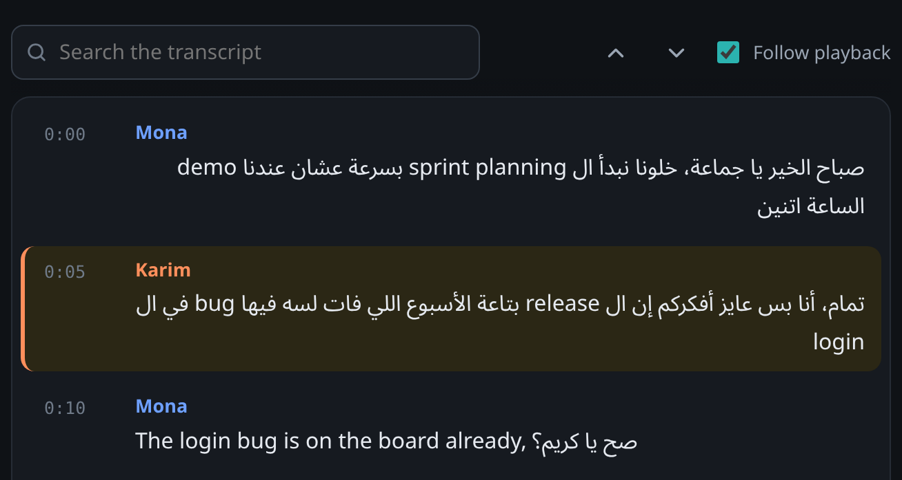</a>
  <br><sub>The line being heard is marked, and each line reads in its own direction.</sub>
</p>

It goes online only for the model downloads, YouTube for the links you add, the hosted services you choose,
GitHub to check for updates when allowed, and Aptabase for the usage counts below. The counts are anonymous, and
the switch in *Settings → About* or `DO_NOT_TRACK=1` turns them off. See [usage counts](docs/13-usage-counts.md)
and the [privacy policy](docs/privacy.md). Downloading from YouTube is for personal use, within YouTube's terms.
Every setting is in [the app notes](docs/09-app.md), and the assistants in [their own notes](docs/11-assistants.md).

## Install

### Windows

Download `Sedjem-<version>-setup.exe` from the [latest release](https://github.com/MohammedEl-sayedAhmed/sedjem/releases/latest).
It installs for your user, without admin rights (about 90 MB). The installer isn't signed, so when it comes from
a browser, Windows SmartScreen warns that its publisher is unknown; choose *More info*, then *Run anyway*.
Sedjem's own updates don't show this warning. The installer's Privacy page has the box for the anonymous usage
counts, and the [privacy policy](docs/privacy.md) lists everything Sedjem sends.

winget doesn't have Sedjem yet; once winget has accepted the package, `winget install MohammedElsayedAhmed.Sedjem`
will install it too.

From source, with Python 3.12 and [Git](https://git-scm.com/), in PowerShell or the Command Prompt:

```powershell
git clone https://github.com/MohammedEl-sayedAhmed/sedjem.git
cd sedjem
py -3.12 -m venv .venv
.venv\Scripts\pip install -r requirements.txt -r requirements-desktop.txt
.\app.cmd
```

`.\app.cmd` opens Sedjem in a window of its own. If nothing opens, `.venv\Scripts\python -m app.desktop` shows
why. To build the installer yourself, see [the desktop notes](docs/10-desktop.md#build-it).

### Linux

Download `Sedjem-<version>-linux-x64.tar.gz` from the
[latest release](https://github.com/MohammedEl-sayedAhmed/sedjem/releases/latest), unpack it and run
`Sedjem/Sedjem`. From source, with Python 3.12 and [uv](https://docs.astral.sh/uv/):

```sh
git clone https://github.com/MohammedEl-sayedAhmed/sedjem.git
cd sedjem
uv venv .venv --python 3.12
uv pip install --python .venv -r requirements.txt
./app.sh              # opens Sedjem at http://127.0.0.1:8765
./app.sh --desktop    # or in a window of its own
```

### First start

Open *Settings → Models* and download whisper-medium (778 MB) or Cohere (1.6 GB). TitaNet-small, the speaker
model (40 MB), comes with the first one. The desktop app opens in a native window where it can, else in a
browser window; the details are in [the desktop notes](docs/10-desktop.md), and so is
[how to uninstall it](docs/10-desktop.md#uninstall) on Windows and Linux.

## Two models, one transcript

Two models get different things wrong. On the same sprint planning, Cohere wrote *eight* and *cache* in Arabic
letters, and whisper-medium turned Nour's Egyptian into formal Arabic. Sedjem lines the two transcripts up by
time, marks the words that differ, and keeps the better line from each as a new version.

<p align="center">
  <a href="site/captures/compare-wide-light.png#gh-light-mode-only">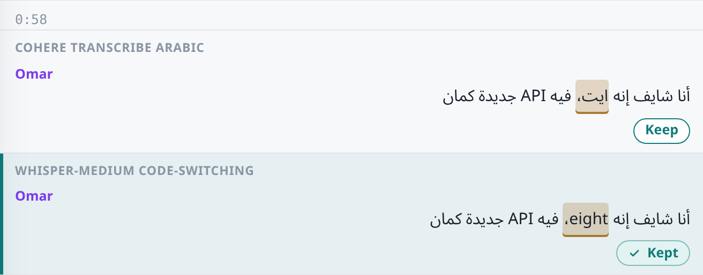</a>
  <a href="site/captures/compare-wide-dark.png#gh-dark-mode-only">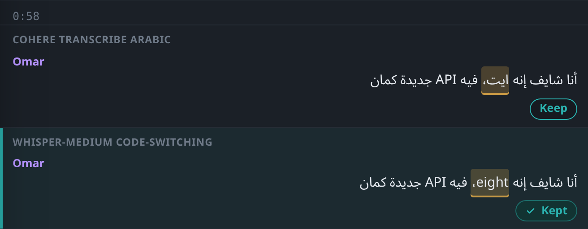</a>
  <br><sub>Omar's line at 0:58, from both models. Keep the row each one got right, and save the result as a new version.</sub>
</p>

Every edit is shown as a diff before it is saved, the way `git diff` shows one, and every earlier version stays.

## Measured on Egyptian speech

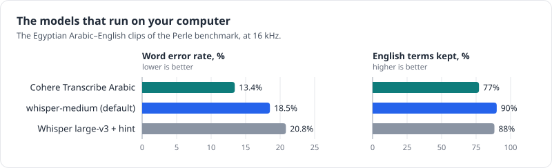

On 40 Egyptian Arabic–English clips from the public [Perle](https://huggingface.co/datasets/Perle-ai/ASR_Code_Switch)
benchmark, Cohere makes the fewest errors and whisper-medium keeps the most English terms in English. On the
project's test laptop (an Intel Core i5-1245U, no NVIDIA GPU), an hour of audio takes about 16 minutes with
Cohere, 32 with whisper-medium and 2 hours with Whisper large-v3.

<details>
<summary>The numbers</summary>

| Model | Runs on | Word error rate, Egyptian test set | English terms kept in English | One hour of audio takes |
|---|---|---|---|---|
| Cohere Transcribe Arabic | your computer | 13.4% | 77% | about 16 min |
| whisper-medium code-switching (default) | your computer | 18.5% | 90% | about 32 min |
| Whisper large-v3 with an Egyptian style hint | your computer | 20.8% | 88% | about 2 h |
| ElevenLabs Scribe v2 | ElevenLabs | 13.1% (published) | not measured | not measured |

ElevenLabs' figure is from [Perle's paper](https://arxiv.org/abs/2605.19069), on its own clips.

</details>

Real meetings are much harder. On an hour of real work meetings, the local models' text differed from
ElevenLabs' on 44% (Cohere) and 49% (whisper-medium) of the words, mostly on short English terms in fast
exchanges. Treat the local transcripts as private drafts; for minutes that people will rely on, a hosted model
is still more accurate. The method and every number are in [the results](docs/03-results.md).

### Who said what

<p align="center">
  <a href="site/captures/speakers-wide-light.png#gh-light-mode-only">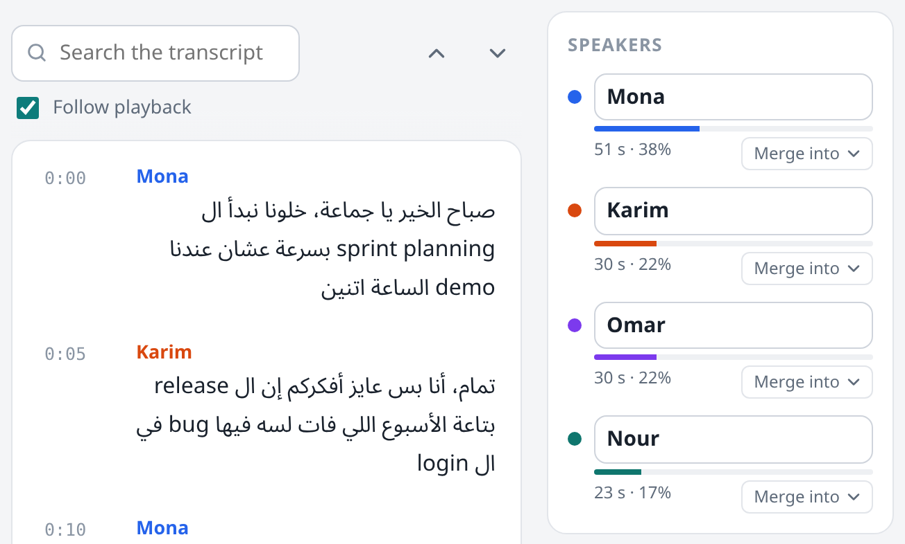</a>
  <a href="site/captures/speakers-wide-dark.png#gh-dark-mode-only">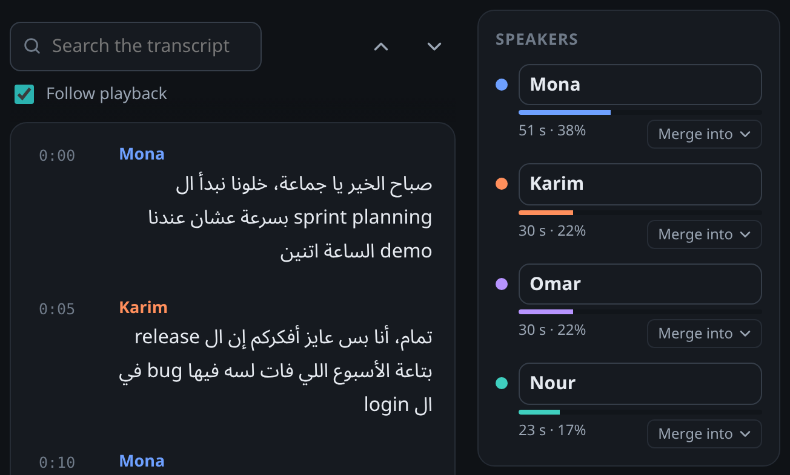</a>
  <br><sub>Each speaker, named by you, with their share of the talking. Two voices of one person merge into one.</sub>
</p>

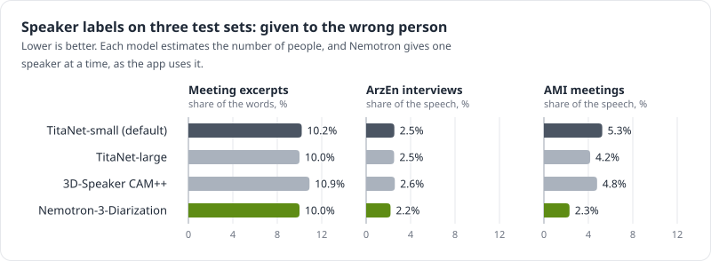

In meetings of two or three people, 8–9% of the words went to the wrong person, against 6% for ElevenLabs' own
labels. TitaNet-small (40 MB) is the default; NVIDIA's Nemotron-3-Diarization gave the least to the wrong
person on every test set and suits meetings of four or more. The method and the sources are in
[speaker labels](docs/04-speaker-labels.md#conclusions).

<details>
<summary>The nine hosted services</summary>

Each one needs your own API key, entered in *Settings → Hosted services*. Apart from ElevenLabs' published
figure, none of them has been measured on Egyptian speech by the project.

| Service | Model the app uses | Arabic–English | Speaker labels |
|---|---|---|---|
| ElevenLabs | Scribe v2 | code-switching, the best published result | built in |
| Speechmatics | Arabic–English bilingual pack | code-switching | built in |
| Google Gemini | Gemini 3.5 Transcribe | code-switching | built in |
| AssemblyAI | Universal-3.5 Pro | code-switching | built in |
| OpenAI | gpt-transcribe, or gpt-4o-transcribe-diarize for labels | told to expect both | built in |
| Groq | Whisper large-v3 with the Egyptian hint | like the local Whisper large-v3 | from the speaker model on your computer |
| Mistral | Voxtral Mini Transcribe 2 | detects the language | built in |
| Deepgram | Nova-3, `ar-EG` | one language per recording | built in |
| Azure AI Speech | fast transcription, `ar-EG` | one language per recording | built in |

Prices, free tiers, what each service keeps and whether it trains on your audio are in
[the app notes](docs/09-app.md#the-models-and-their-settings).

</details>

## How it works

The recording is cut at pauses (Silero VAD) into pieces of up to 25 seconds, and each piece goes to the speech
model. Separately, a voiceprint model (NVIDIA TitaNet-small by default) describes the voice every 0.75 seconds,
and spectral clustering groups those voiceprints into speakers; Nemotron-3-Diarization does both in one model.
Whisper gives every word a time, so each word gets the speaker heard at that moment; for Cohere, which gives no
word times, the pieces are cut where the voice changes.

The app is a small Python web server bound to 127.0.0.1 with a plain HTML and JavaScript interface, shown in a
native window and packaged with PyInstaller. Your transcriptions, their versions, audio copies and API keys stay
in the app's data folder.

The same pipeline works from the command line:

```sh
.venv/bin/python transcribe.py meeting.m4a --speakers 3        # or --speakers 0 to estimate
.venv/bin/python transcribe.py call.wav --engine cohere --speakers 2
```

Setup, options and speeds are in [the command-line notes](docs/05-command-line.md).

## The project notes

Sedjem came out of a search for speech-to-text models that handle Egyptian Arabic–English meetings on an
ordinary laptop. R2T2, the model the search started from, wrote most English terms in Arabic letters. The
[project notes](docs/README.md) have the whole story, from the first trials to the market research; these five
are the ones to start with:

- [Results](docs/03-results.md): method, public benchmark, phone audio, real meetings, caveats
- [Speaker labels](docs/04-speaker-labels.md): how voices are told apart, and which speaker model to use
- [Recommendation](docs/07-recommendation.md): what to use for which job
- [The app](docs/09-app.md): using Sedjem, versions, comparing, its settings, API keys, privacy
- [Privacy policy](docs/privacy.md): everything Sedjem contacts and when, what stays on the computer, and turning the usage counts off

## Activity

<p align="center">
  <a href="https://github.com/MohammedEl-sayedAhmed/sedjem/blob/stats/README.md#gh-light-mode-only"></a>
  <a href="https://github.com/MohammedEl-sayedAhmed/sedjem/blob/stats/README.md#gh-dark-mode-only"></a>
</p>

The stats workflow redraws these charts every day from GitHub's own numbers. The tables behind them are in
[the stats summary](https://github.com/MohammedEl-sayedAhmed/sedjem/tree/stats#readme).

### Usage

Totals from the app's anonymous usage counts, published once a month
([how they are made](docs/13-usage-counts.md#public-totals)):

<!-- usage-totals:start -->
No totals yet: the counts start with Sedjem 0.3.0, and the first month's totals will be here once that month has
been exported.
<!-- usage-totals:end -->

## More

Each stable version is announced in the
[Discussions](https://github.com/MohammedEl-sayedAhmed/sedjem/discussions), where questions and ideas are welcome
too. On GitHub, *Watch → Custom → Releases* sends an email for each release, the nightly previews included. Bugs
go in [the issues](https://github.com/MohammedEl-sayedAhmed/sedjem/issues).

<details>
<summary>Nine screens of the app</summary>

<p align="center">
  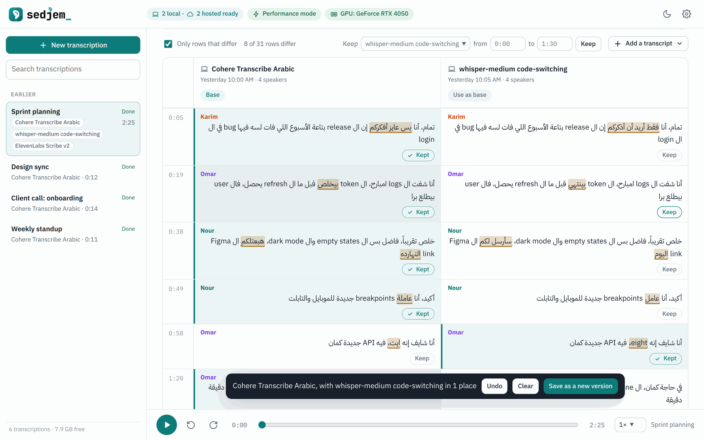
</p>
<p align="center">The whole compare view: two models on the same recording, lined up by time, only the rows that differ.</p>

<table>
  <tr>
    <td width="50%">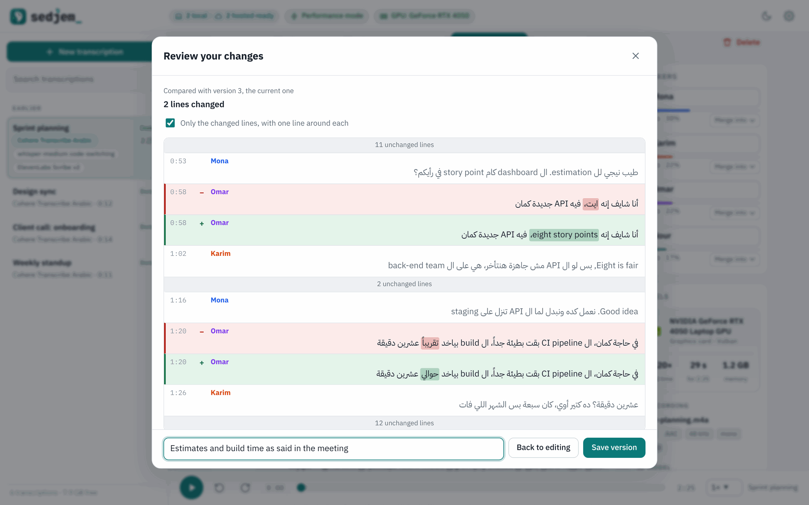</td>
    <td width="50%">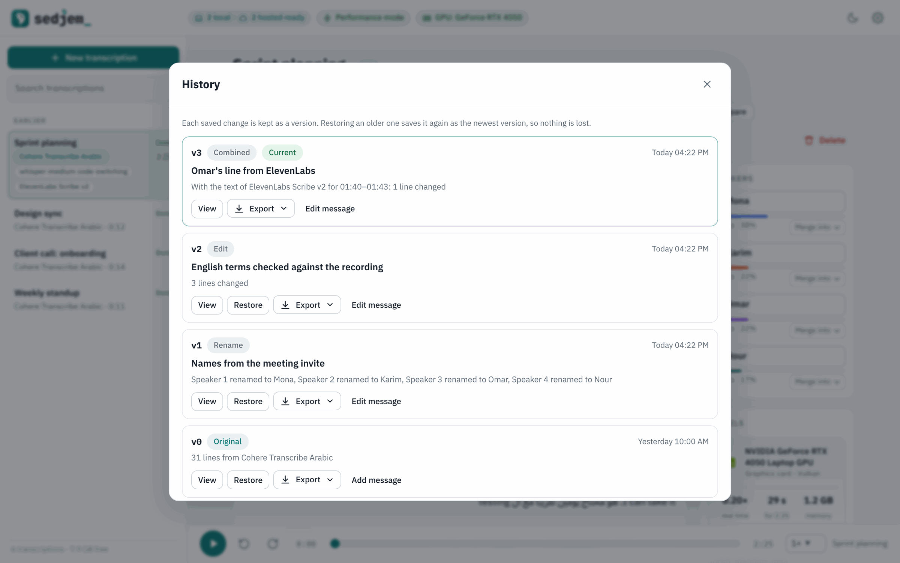</td>
  </tr>
  <tr>
    <td>Every edit session is reviewed as a diff before it is saved.</td>
    <td>The history keeps the model's output as version 0 and every change after it.</td>
  </tr>
  <tr>
    <td>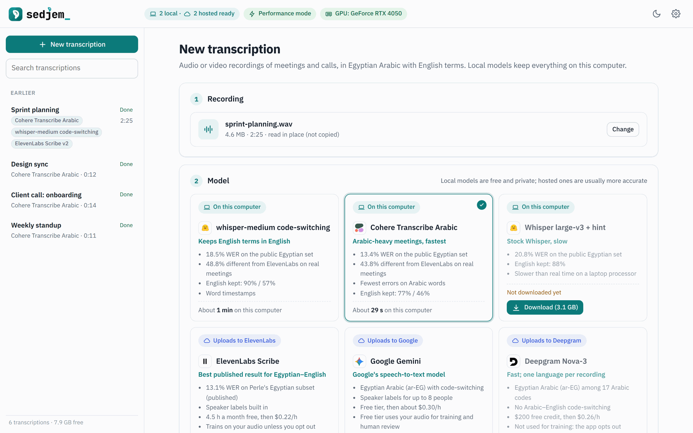</td>
    <td>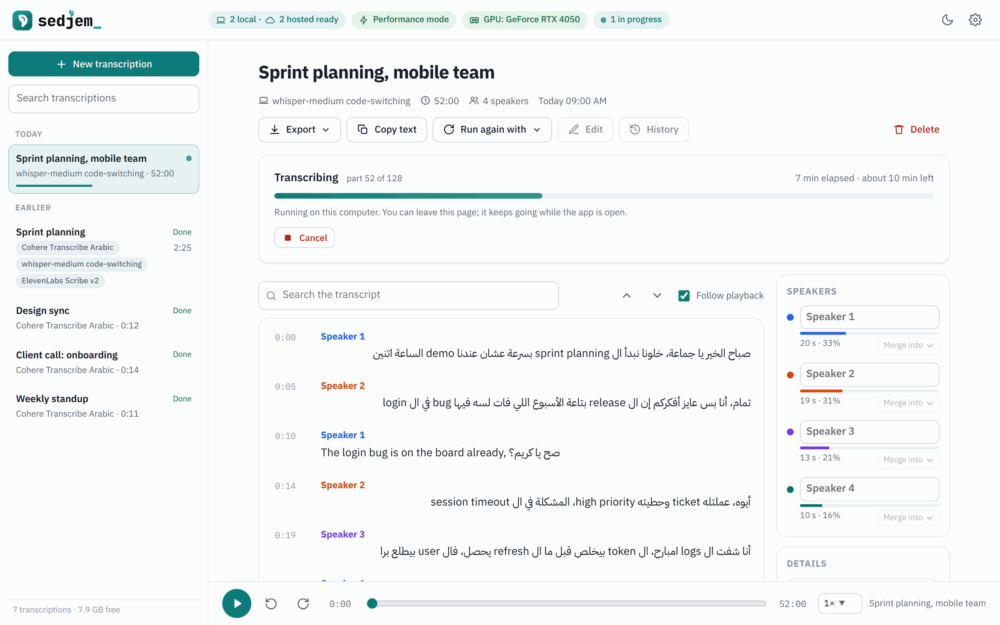</td>
  </tr>
  <tr>
    <td>Pick a recording and a model. Each card lists what that model is good at.</td>
    <td>The lines appear while the model works. Cancel at any time.</td>
  </tr>
  <tr>
    <td>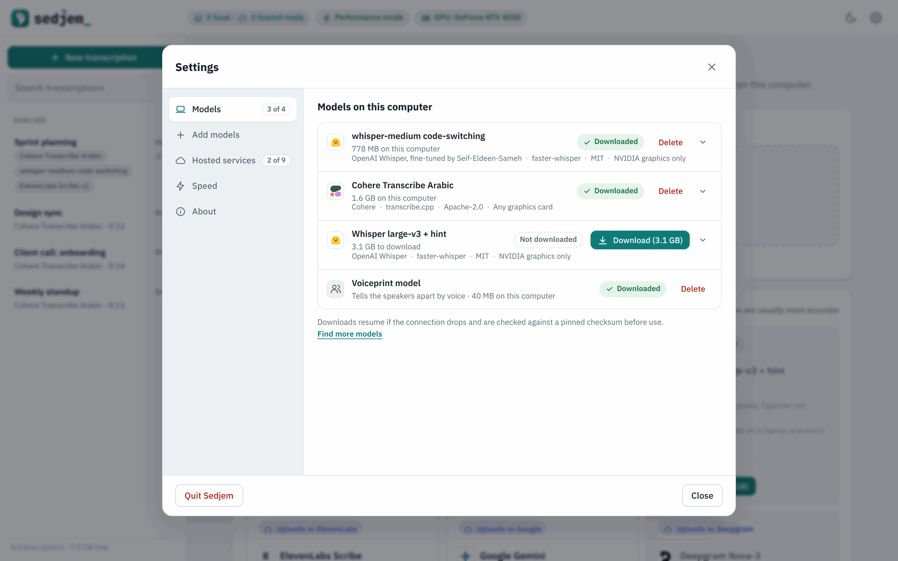</td>
    <td>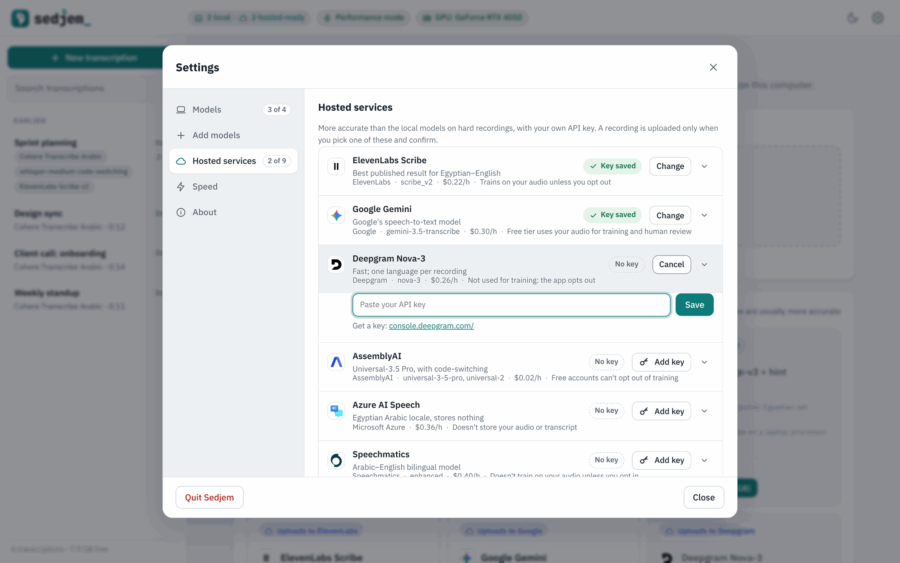</td>
  </tr>
  <tr>
    <td>Download or remove the local models.</td>
    <td>Add a key for a hosted service. Each form opens only when asked.</td>
  </tr>
  <tr>
    <td>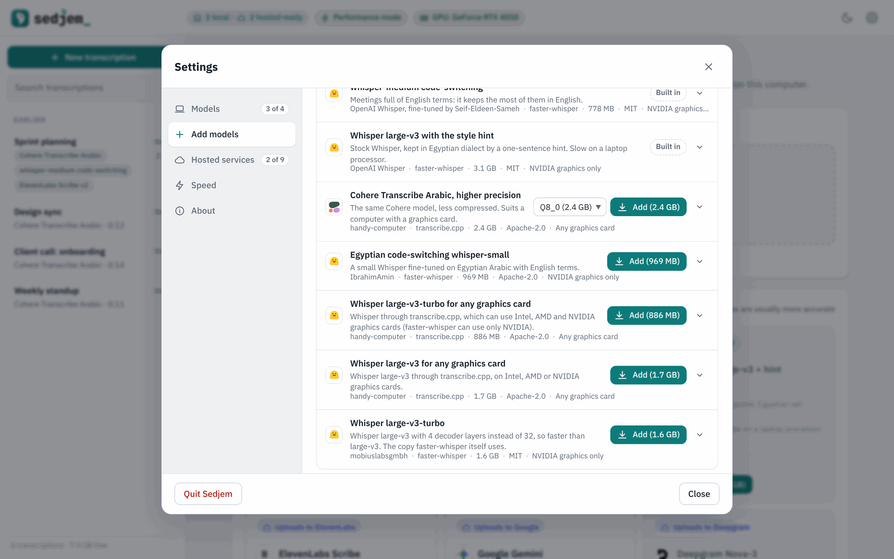</td>
    <td>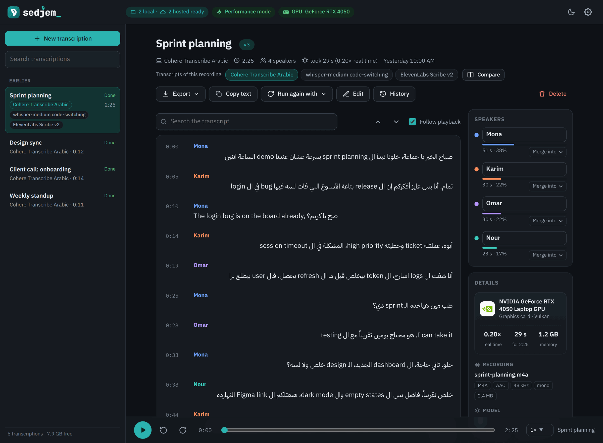</td>
  </tr>
  <tr>
    <td>More models for these meetings, added in one click.</td>
    <td>Dark theme.</td>
  </tr>
</table>

</details>

The meeting in the images is made up, and so are the names.

## Name and logo

Sedjem is the ancient Egyptian word for "to hear", written with the sign of an ear. The logo draws that
ear as the app icon and again as the dot of the j, and ends the name with a typing cursor: sound heard,
then written down. The idea, the colour and mono versions, how to use them and the SVG and PNG files are
in [docs/brand](docs/brand/README.md).

## Thanks

Sedjem stands on other people's work: the
[whisper-medium Arabic–English code-switching fine-tune](https://huggingface.co/Seif-Eldeen-Sameh/whisper-medium-arabic-codeswitched-ct2),
Cohere Transcribe Arabic (the
[GGUF build](https://huggingface.co/handy-computer/cohere-transcribe-arabic-07-2026-gguf) from
handy-computer, run with transcribe.cpp), OpenAI Whisper through
[faster-whisper](https://github.com/SYSTRAN/faster-whisper) and CTranslate2,
[sherpa-onnx](https://github.com/k2-fsa/sherpa-onnx) with NVIDIA TitaNet and 3D-Speaker CAM++,
[NVIDIA Nemotron-3-Diarization](https://huggingface.co/nvidia/Nemotron-3-Diarization) (run with NumPy), Silero VAD, PyAV,
[pywebview](https://pywebview.flowrl.com/), PyInstaller and Inno Setup. The benchmarks use the
[Perle](https://huggingface.co/datasets/Perle-ai/ASR_Code_Switch),
[ArzEn](https://aclanthology.org/2020.lrec-1.523/) and [AMI](https://groups.inf.ed.ac.uk/ami/corpus/)
test sets; the papers and licences behind the speaker labels are listed in
[their references](docs/04-speaker-labels.md#references).

## Licence

Sedjem is made by Mohammed El-sayed Ahmed and is free software under the
[GNU Affero General Public License v3.0](LICENSE) (AGPL-3.0-only). You can use, study, change and
share it. If you distribute a modified version, or run one as a service for others, you must publish
its source under the same licence, and keep the author credit in its About section and README (the
[NOTICE](NOTICE) file has the exact terms). Versions published up to 25 September 2026 were under the
MIT licence.

For use without these conditions, for example inside a closed-source product, commercial licences
are available from the author: contact [Mohammed El-sayed Ahmed](https://github.com/MohammedEl-sayedAhmed).
Contributions are welcome; by sending one you agree that it may be distributed under both the AGPL
and the commercial licence.

<details>
<summary>The models', libraries' and logos' own licences</summary>

The models keep their own licences: the whisper-medium fine-tune and Whisper large-v3 are MIT (check
the fine-tune's card for its training data), Cohere Transcribe Arabic and the Whisper tokenizer are
Apache-2.0, NVIDIA TitaNet-small comes under the NeMo toolkit's Apache-2.0 licence and TitaNet-large
is CC-BY-4.0, 3D-Speaker CAM++ is Apache-2.0, and
NVIDIA Nemotron-3-Diarization is under the OpenMDW 1.1 licence, which allows commercial use. The desktop build bundles
third-party packages under their own licences, including the FFmpeg libraries that come with PyAV
(LGPL). The hosted services are used under their own terms. The full-colour logos of the models,
services and some systems are the brands' own files, taken from their brand pages and sites (and one
from [LobeHub's icons](https://github.com/lobehub/lobe-icons), MIT); each file's source and the terms
found for it are listed in [app/static/logos/SOURCES.md](app/static/logos/SOURCES.md). The
single-colour logos of the hardware and the other systems come from
[Simple Icons](https://simpleicons.org) (CC0). The trademarks belong to their owners, and the logos
are shown only to identify the hardware, systems, models and services the app names; this does not
mean that any of them endorses Sedjem.

</details>
