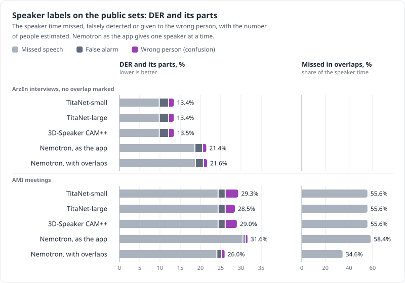
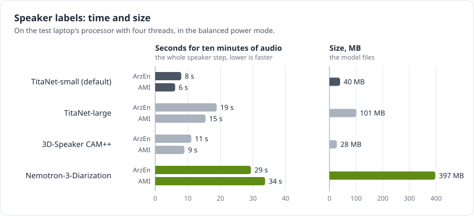

# Speaker labels

None of the speech-to-text models in the project's tests label speakers, so telling speakers apart
(diarization) is a separate step that runs locally, in `speakers.py`. The papers, data sets and
models named here are listed with their licences under [References](#references).

## How it works

1. Find the speech. Silero VAD ([Silero Team 2024](#references)) marks where anyone is talking.
2. Take voiceprints. A 1.5-second window slides over the speech every 0.75 s. On very long
   recordings the step grows so that there are at most 2,000 windows; if many short turns still
   exceed that, an evenly spaced subset is clustered and every other window joins the nearest
   speaker. For each window a speaker-embedding model, by default NVIDIA TitaNet-small
   ([Koluguri, Park and Ginsburg 2022](#references); 40 MB, trained with telephone speech among other
   data), produces a voiceprint that captures timbre and pitch: what a voice sounds like, not what it
   says.
3. Group by voice. Spectral clustering (NME-SC, [Park et al. 2020](#references)) groups the
   voiceprints into N speakers. The neighbour count is tuned for each recording, so a handful of odd
   windows (noise, crosstalk, laughter) can't become a speaker of their own. N comes from
   `--speakers N`, and `--speakers 0` estimates it from the eigengap.
4. Smooth. Within each speech segment, a window whose two neighbours agree with each other takes
   their speaker.
5. Attribute the text. Whisper returns a timestamp for every word, so each word goes to the speaker
   whose voice is active at that moment, and consecutive words from one speaker form a line. Cohere
   and the Qwen3-ASR family give no word timestamps. For them, every pause-delimited chunk is cut
   where the voice timeline changes speaker (snapped to the quietest 20 ms within ±0.3 s; pieces
   under 0.3 s join a neighbour), and each piece is transcribed and labelled. Either way, all the
   speech is transcribed. With `--align`, Cohere's words get times from forced alignment instead
   ([below](#forced-alignment-experimental)).

Everything runs on the CPU with sherpa-onnx and a small ONNX voiceprint model: no PyTorch, no
account, no upload. Speaker labels add a few seconds, about 2–3 s on the 2-minute test call
(whisper-medium took 68.4 s without them and 70.8 s with them). With TitaNet-small the voiceprints
take 4–8 s per 10-minute excerpt, plus the clustering. `--voiceprint-model` swaps in another model.

## What was tried, and what went wrong

| Version | Result | Problem |
|---|---|---|
| sherpa-onnx's built-in pipeline, counting speakers itself | 4 speakers on the test call (69 s, 49 s, 5 s, 2 s) | invented two tiny speakers |
| the same, told there were 2 | 111 s against 14 s | merged both real voices into Speaker 1; Whisper invented text for the fragments left to Speaker 2 |
| voiceprints and spectral clustering, first version | 57 s against 44 s, turns alternate | The code review found a bug: for the Cohere and llama engines, the speaker turns covered only the middle 0.75 s of each window, so 13–30% of the speech (up to about 46% on long calls, where the window step grows) was never transcribed. It also switched smoothing off on long recordings and misreported talk time |
| fixed version, WeSpeaker ResNet34 voiceprints | 58 s against 44 s on the test call; every sample of speech reaches the model | 25.7% of words credited to the wrong person on the meeting excerpts |
| current version, TitaNet-small voiceprints | | 11.7% wrong on the meeting excerpts; number of speakers estimated right in 5 of 6 |

The failure with 2 speakers is a known weakness of agglomerative clustering. When a few outlier
segments are further from everyone than the two real voices are from each other, the two voices
merge first.

## Accuracy on real meetings

This was measured on the six 10-minute meeting excerpts, with 2–5 people each (see
[the results](03-results.md#real-meetings)), as WDER
([El Shafey, Soltau and Shafran 2019](#references)): the share of words credited to the wrong
person. Our words are aligned to the hand-corrected
ElevenLabs reference, and our Speaker 1, 2 and so on are matched to the real people in the way that
agrees best. `bench/compare_voiceprints.py` relabels the same Whisper words
([Radford et al. 2023](#references)) with each voiceprint model, so only the speaker step differs.

| Voiceprint model | Size | Wrong speaker, true count given | Wrong speaker, count estimated (`--speakers 0`) | Count estimated right |
|---|---|---|---|---|
| TitaNet-small (default) | 40 MB | 11.7% | 10.2% | 5 of 6 |
| 3D-Speaker CAM++ (Chinese and English) | 28 MB | 11.7% | 10.9% | 4 of 6 |
| TitaNet-large | 101 MB | 12.2% | 10.0% | 5 of 6 |
| WeSpeaker ResNet34 (the first default) | 26 MB | 25.7% | 22.9% | 2 of 6 |
| WeSpeaker ResNet152 | 79 MB | 36.9% | 29.9% | 3 of 6 |


*Words credited to the wrong person with each voiceprint model, given the true number of speakers or estimating it; the right column counts the excerpts where the estimate was right.*

Per excerpt with TitaNet-small and the true count: 4.6% (2 people), 7.8%, 10.4% and 2.6% (3 people
each), 16.5% (2 people) and 38.4% (5 people).

For comparison, ElevenLabs' own raw labels differ from the hand corrections on 6.5% of the words
over the same stretches, and on 5.9% over the five 2–3-person excerpts, where TitaNet-small gets
9.0%. That comparison favours ElevenLabs, since the corrections started from its labels. With
TitaNet, the local labels come within a few points of ElevenLabs on meetings of two or three
people, and remain weak on larger meetings.


*Per excerpt, TitaNet-small against ElevenLabs' raw labels, both scored against the hand corrections; the ElevenLabs figures per excerpt are in [the results](03-results.md#real-meetings).*

The two WeSpeaker models ([Wang, Liang et al. 2023](#references); their ResNet34-LM and ResNet152-LM
versions), trained on VoxCeleb2 alone ([Chung, Nagrani and Zisserman 2018](#references); celebrity
interviews), do worst, and the models trained with telephone and large multi-speaker data (TitaNet,
and 3D-Speaker's CAM++, [Wang, Zheng et al. 2023](#references)) do best, as the research predicted.
With TitaNet the estimate missed only on the 5-person excerpt. There it found fewer
speakers than were present (2 of 5 with TitaNet-small, 3 with TitaNet-large) and still scored better
than clustering into the true 5 (21.6% against 38.4%, and 16.0% against 41.0%). So on larger
meetings `--speakers 0` is a reasonable choice even when the headcount is known. The other models
also missed on 2–3-person excerpts, and not always by finding too few: CAM++ found 3 speakers for 2
people on one excerpt and scored worse there (19.0% against 17.0% with the true count).

## NVIDIA Nemotron-3-Diarization

NVIDIA's Nemotron-3-Diarization ([NVIDIA 2026](#references); released in September 2026, about
100M parameters, OpenMDW 1.1 licence, which allows commercial use) replaces all of the steps above
with one model. Every 10 ms it gives the probability that each of up to 8 speakers is talking, so it
also hears when two people talk at once. It is a Transformer that keeps the speaker cache of
Streaming Sortformer ([Medennikov et al. 2025](#references)) and numbers the speakers by when they
first speak, as Sortformer does ([Park et al. 2025](#references)). Its model card lists about
10,000 hours of real conversations among its training data, AMI's training and development
meetings among them, and Arabic is not among the languages it lists. It can be chosen instead of TitaNet-small in
Settings → Models, or with `--voiceprint-model models/diarization/Nemotron-3-Diarization` on the
command line.

Sedjem runs NVIDIA's weights with NumPy alone (`nemotron.py`), following the Transformers
implementation ([Wolf et al. 2020](#references)) step by step: a log-mel spectrogram, 8 of its 10 ms
frames stacked into one, then the recording in chunks of 27.2 s, each seen together with a cache of
up to 264 earlier frames that keeps the clearest ones of every speaker, so the speaker numbers hold
from one chunk to the next. On the six
excerpts its probabilities stayed within 0.000007 of Transformers' on five and within 0.015 on the
sixth, and not one 10 ms frame changed who was talking (`bench/check_nemotron.py`, which needs
PyTorch and Transformers; `tests/test_nemotron.py` checks a tiny random model the same way without
them).

The probabilities become the same kind of timeline as the voiceprints: in 80 ms steps, speech is where
someone's probability is above 0.5, and it goes to the most likely speaker, with the same 3-step
smoothing. Each word goes to the speaker most likely over the whole word, which put 10.0% of the words
on the wrong person against 10.2% when only the middle of the word counts. With the true count N
given, only the N speakers it heard longest get any. `bench/compare_nemotron.py` labels the same
Whisper words this way and with TitaNet-small in the same run, so only the speaker step differs.

| Speaker labels | Size | Wrong speaker, true count given | Wrong speaker, count estimated | Count estimated right | Seconds per 10-minute excerpt |
|---|---|---|---|---|---|
| TitaNet-small voiceprints and clustering | 40 MB | 11.7% | 10.2% | 5 of 6 | 5 |
| Nemotron-3-Diarization | 397 MB | 10.0% | 10.0% | 6 of 6 | 30 |

It counted the people right on all six excerpts, including the 5-person one where TitaNet-small found
2, so giving it the true count changed nothing. On that excerpt it put 19.4% of the words on the
wrong person, against 38.4% for TitaNet-small with the true count and 21.6% with its estimate. On the
five excerpts of two or three people the two are level at 9.0% pooled: per excerpt 2.7%, 8.4%,
10.0%, 3.2% and 17.7% for Nemotron, against 4.6%, 7.8%, 10.4%, 2.6% and 16.5%.


*Per excerpt, TitaNet-small given the true number of people against Nemotron, which estimated it right on all six. On m6, the 5-person excerpt, TitaNet-small's own estimate (2 people) is shown too.*

It hears two or more people at once in 4.0% of the speech (0.6–8.0% per excerpt). Sedjem gives every
word one speaker, and so does the reference, so this is not an advantage yet: of the 169 words said
in those stretches, Nemotron's most likely speaker was the wrong one for 29.6%, against 26.6% for
TitaNet-small with the true count and 20.1% with its estimate. Making use of the overlap would mean
transcribing each voice of an overlap separately.

The times are for the speaker step alone, with 4 threads on the test laptop in the balanced power
mode, on 28 October 2026. Transformers with PyTorch took 14 s for the same work, so NumPy is about
twice as slow; with all 12 threads, NumPy's default, it was twice as slow again, so `nemotron.py`
keeps it to 4. Both models are small next to transcription: Whisper took 0.53 times real time on these
excerpts in the performance mode, about 320 s each. The Nemotron step peaked at 0.65 GB of memory.

TitaNet-small stays the default: it is a tenth of the size and six times faster, and level with
Nemotron on meetings of two or three people. Nemotron is the better choice for larger meetings, where
it counted the people right and put half as many words on the wrong person. It hears at most 8
speakers.

## Public test sets: ArzEn and AMI

The meeting excerpts above are private, so the speaker models were also scored on two public sets
that anyone can download, with `bench/compare_arzen.py` and `bench/compare_ami.py`
([how to run them](05-command-line.md#benchmark)):

- ArzEn ([Hamed, Vu and Abdennadher 2020](#references); CC BY-SA 4.0): 38 informal interviews held
  at the German University in Cairo, 12.1 hours of Egyptian Arabic mixed with English, at 16 kHz.
  Each has one interviewee and the same two interviewers, a man and a woman (two recordings have only one of
  them). The corpus marks who speaks only through its transcription's segments, which never overlap
  and run from one cut to the next, so the pauses inside them, and often the silence before the next
  speaker, count as speech.
- AMI ([Carletta et al. 2006](#references); CC BY 4.0): English meetings, many of the speakers not
  native. Its standard test set, that of its Full-corpus-ASR partition, is 16 meetings, 9.1 hours,
  15 of them of four people and one of three, from headset microphones mixed into one channel, with
  the reference turns taken from the word timings. The audio and the turns are the `ihm` set of
  `diarizers-community/ami` on Hugging Face ([Akesbi and Gandhi 2024](#references)), at a pinned
  revision, made from the AMI diarization setup of [Landini et al. 2022](#references). Two or more
  people talk at once in 14.6% of the speech, which is 27.0% of the speaker time.

Both are scored on 10 ms frames, with each model's speakers matched one to one to the real people in
the way that agrees best, by two measures:

- Wrong speaker on speech, which is closest to how Sedjem uses the labels. The speech model
  transcribes wherever anyone talks, and each word gets the speaker of the timeline at that moment,
  also where the speaker model heard no one. So every 10 ms of the reference's speech is labelled
  that way, and this is the share of it that goes to someone who isn't talking then. It is the
  time-based counterpart of the words on the wrong person above.
- DER (diarization error rate, as NIST's Rich Transcription evaluations score it;
  [Fiscus et al. 2006](#references)), the usual measure: the share of the reference's speaker time that
  is missed, falsely detected or given to the wrong person, summed over the speakers, so an overlap
  of two people counts twice. Nothing is forgiven around the turns (no collar) and overlaps are
  scored, the strictest setup; published AMI figures use several others, so compare them with care.
  ArzEn's turns include pauses, so its DER is also given with a 0.25 s collar: the frames within
  0.25 s of a speaker starting or stopping are not scored, which leaves 96% of its speech.

Nemotron has two rows. As the app uses it, it gives one speaker at a time (the timeline described
above). Its own output, everyone above 0.5, includes the overlaps but gives no single speaker for a
word, so it has no wrong-speaker figure. The tables are for the count estimated (`--speakers 0`).
The time is for the whole speaker step, per 10 minutes of audio, with 4 threads on the test laptop
in the balanced power mode, on 29 October 2026.

### ArzEn: interviews in Egyptian Arabic and English

| Speaker labels | Wrong speaker on speech | DER | Missed / false alarm / confusion | DER with a 0.25 s collar | Count estimated right | Seconds per 10 minutes |
|---|---|---|---|---|---|---|
| TitaNet-small voiceprints (default) | 2.5% | 13.4% | 9.8% / 2.3% / 1.3% | 11.3% | 38 of 38 | 8 |
| TitaNet-large voiceprints | 2.5% | 13.4% | 9.8% / 2.3% / 1.3% | 11.3% | 38 of 38 | 19 |
| 3D-Speaker CAM++ voiceprints | 2.6% | 13.5% | 9.8% / 2.3% / 1.3% | 11.3% | 38 of 38 | 11 |
| Nemotron, one speaker at a time (as the app) | 2.2% | 21.4% | 18.6% / 1.9% / 0.9% | 19.2% | 29 of 38 | 29 |
| Nemotron, overlaps included | | 21.6% | 18.7% / 2.0% / 0.9% | 19.4% | 29 of 38 | 29 |

The three voiceprint models score alike, count the people right in every interview, and score the
same with the count given. Nemotron put a little less of the speech on the wrong person (2.2%
against 2.5%, and 1.5% against 1.7% with the collar) and confused people less (0.9% against 1.3%).
Its DER is higher because it hears no one in 18.7% of the reference's speech, where Silero VAD,
which finds the speech for the voiceprints, hears no one in 9.8%. The reference counts pauses as
speech, so part of that is pauses, and the app still gives every word there a speaker. In 9
interviews it heard a fourth voice, for 0.6 to 5 seconds, which makes the count wrong but changes
little else.

One interview, R14, holds 10–12% of every model's wrong-speaker time. TitaNet-small and Nemotron
each put about 13% of its speech on someone other than the reference does, and they agree with each
other on 99% of it: mostly, both give to an interviewer what the reference gives to the interviewee.
That points to mistakes in the reference rather than in the models; without R14, TitaNet-small is at
2.3% and Nemotron at 2.0%. The interviews also share their interviewers, so the set has 40 voices,
and every recording asks the same of the models: two interviewers, a man and a woman, and one
interviewee. ArzEn marks no overlap, so it can't show what Nemotron's overlap is worth. AMI can.

### AMI: English meetings with much overlap

| Speaker labels | Wrong speaker on speech | DER | Missed / false alarm / confusion | Speaker time missed in overlaps | Count estimated right | Seconds per 10 minutes |
|---|---|---|---|---|---|---|
| TitaNet-small voiceprints (default) | 5.3% | 29.3% | 24.4% / 1.7% / 3.2% | 55.6% | 15 of 16 | 6 |
| TitaNet-large voiceprints | 4.2% | 28.5% | 24.4% / 1.7% / 2.4% | 55.6% | 15 of 16 | 15 |
| 3D-Speaker CAM++ voiceprints | 4.8% | 29.0% | 24.4% / 1.7% / 2.9% | 55.6% | 14 of 16 | 9 |
| Nemotron, one speaker at a time (as the app) | 2.3% | 31.6% | 30.5% / 0.6% / 0.5% | 58.4% | 14 of 16 | 34 |
| Nemotron, overlaps included | | 26.0% | 24.0% / 1.2% / 0.7% | 34.6% | 14 of 16 | 34 |

Overlap is what makes AMI hard. A timeline with one speaker at a time misses at least one voice
wherever two people talk, and that is most of what the voiceprint models miss: 15.0% of the speaker
time, against 9.3% where one person talks. As the app uses it, Nemotron put about half as much of
the speech on the wrong person as the voiceprint models (2.3% against 4.2–5.3%), with about a fifth
of their confusion, but it misses more of the speech where one person talks (14.7% of the speaker
time, against 9.3%), so its DER is the highest. Its own output, overlaps included, has the lowest
DER, 26.0%, and misses a third of the speaker time in overlaps instead of more than half: when it
hears two or more people at once it is right 91.5% of the time, and it hears 48.3% of the overlap.
With the count given, the voiceprint models put 4.5% (TitaNet-small), 5.4% (TitaNet-large) and 4.8%
(CAM++) of the speech on the wrong person, and Nemotron 2.3% again. Every model got the count wrong
on one or two meetings.

Nemotron has heard meetings like these before. Its model card lists AMI's training and development
meetings, though not these 16, among its training data, while TitaNet's cards list no meetings
(VoxCeleb, Fisher, Switchboard and LibriSpeech, and NIST's speaker recognition sets for
TitaNet-large), so part of its lead here may come from that. The card also gives
Nemotron a DER of 9.25% on the same 16 meetings, scored against references made by forced alignment
instead of the word timings used here; the two figures can't be compared.



*DER on both public sets, split into its parts. Missed speech is most of every model's DER. Nemotron as the app misses more of the speech and confuses people less; with its overlaps kept, it has the lowest DER on AMI and misses a third of the speaker time in overlaps instead of more than half.*

## Conclusions


*The share of the words (meeting excerpts) or of the speech (ArzEn and AMI) given to the wrong person, with the number of people estimated by each model, as the app does by default.*

The four speaker models that Settings offers were scored on three sets: the six private meeting
excerpts in Egyptian Arabic and English (an hour, two to five people each), ArzEn's 38 interviews in
the same languages (12.1 hours, three people in most), and AMI's 16 English meetings (9.1 hours,
mostly four people, with much overlap). They agree on these points:

- Nemotron-3-Diarization put the least on the wrong person on all three, with the number of people
  estimated: 10.0% of the words on the excerpts against 10.2% for TitaNet-small, 2.2% of the speech
  on ArzEn against 2.5%, and 2.3% on AMI against 4.2–5.3% for the voiceprint models.
- Its lead grows with the number of people. It is about level with TitaNet-small on meetings of two
  or three people (9.0% each) and on the interviews, puts less than half as much on the wrong person
  on AMI's meetings of four, and on the 5-person excerpt gives 19.4% of the words to the wrong person,
  against 21.6% with TitaNet-small's estimate of the count and 38.4% with the true count.
- It is the only one of the four that hears two people talking at once. On AMI it heard 48.3% of
  the overlapping speech and was right 91.5% of the time when it heard an overlap, and with its
  overlaps kept it has the lowest DER (26.0%, against 28.5–29.3%). The app does not use this yet:
  every word gets one speaker.
- DER ranks the models differently. As the app uses it, Nemotron hears no one in more of the speech
  than Silero VAD does, so its DER is the highest on both public sets (21.4% against 13.4–13.5% on
  ArzEn, 31.6% against 28.5–29.3% on AMI). The app still gives every word there a speaker, which is
  why the wrong-speaker share is closer to what a reader of the transcript sees.
- Its count of the people was right on all six excerpts but less often on the public sets: 29 of 38
  interviews and 14 of 16 meetings, against 38 and 15 for TitaNet-small. On ArzEn the misses were a
  fourth voice heard for a few seconds.
- It costs more: 397 MB against 40 MB, and 29–34 s for 10 minutes of audio against 6–8 s on the
  public sets (30 s against 5 s on the excerpts), with at most 0.65 GB of memory. Both are small
  next to transcription, which took about 320 s per 10-minute excerpt with whisper-medium in the
  performance mode.
- The three voiceprint models are within about a point of each other on every set. TitaNet-large
  is a little ahead of TitaNet-small with the count estimated (4.2% against 5.3% on AMI) and behind
  with it given (5.4% against 4.5%), at two to three times the size and time. CAM++ counted the
  people right less often (4 of 6 excerpts, 14 of 16 meetings).



*The speaker step alone, with the number of people estimated; transcription takes far longer.*

The sets are small and were run on one laptop. The meeting excerpts are an hour of private audio,
with reference labels corrected by hand from ElevenLabs' output. ArzEn's reference counts pauses as
speech, marks no overlap, has the same two interviewers throughout and, judging by R14, some
mislabelled turns. AMI is in English, and Nemotron was trained on its other meetings. The excerpts
were scored word by word, ArzEn and AMI on 10 ms
frames without a collar, and the times are from the balanced power mode. Arabic is not among the
languages of Nemotron's model card, and it still put the least on the wrong person on the two sets in
Egyptian Arabic.

## Recommendation

TitaNet-small stays the default. It is a tenth of Nemotron's size and four to six times faster, its
count of the people was right more often on the public sets, and on interviews and on meetings of
two or three people Nemotron is only about level with it.

Choose Nemotron-3-Diarization in Settings → Models for meetings of four or more people, and for
recordings where people often talk over each other. On AMI's meetings of four it put less than half
as much of the speech on the wrong person as TitaNet-small, and it counted the people of the 5-person
excerpt right where TitaNet-small found 2. It hears at most 8 speakers.

TitaNet-large and 3D-Speaker CAM++ gained nothing consistent over TitaNet-small on these sets, and
both take longer.

The overlaps that Nemotron hears are not used yet. Transcribing each voice of an overlap on its own
would show what they are worth ([next steps](07-recommendation.md#next-steps)), and a public set of
Egyptian Arabic meetings with the overlaps marked would test it better than ArzEn's interviews can.

## Forced alignment (experimental)

Cutting Cohere's audio at every speaker change means each piece is transcribed without the words
around it. The alternative is to transcribe the whole pause-delimited chunk and then find where each
word falls in the audio, which is what forced alignment does. `align.py` does this with
[ctc-forced-aligner](https://github.com/MahmoudAshraf97/ctc-forced-aligner) and the MMS-300m
forced-aligner model (`MahmoudAshraf/mms-300m-1130-forced-aligner`, 1,130 languages, 1.26 GB; MMS
is [Pratap et al. 2024](#references)). The model reads romanized text, so the Arabic and the English
words mixed into it are both romanized with uroman ([Hermjakob, May and Knight 2018](#references))
first. Each word then gets the speaker whose voice is active at its midpoint, as with
Whisper. A chunk where the voice timeline shows a single speaker skips the alignment, because every
word in it gets that speaker anyway. If an alignment fails, the chunk's words are spread evenly over
it.

On the six meeting excerpts the aligned labels put 11.9% of words on the wrong speaker, against
10.9% with the audio cut at speaker changes, and the text is the same as Cohere's without labels
(43.1% WER against 43.8%). The costs: English kept falls from 46% to 39%, processing goes from 0.26
to 0.43 times real time and peak memory from 3.0 to 4.8 GB, and it needs PyTorch. The aligner model
is licensed CC-BY-NC-4.0, for non-commercial use only. For those reasons it is not the default. The
full comparison is in [the results](03-results.md#variations-on-cohere), and the setup in
[the command-line notes](05-command-line.md#forced-alignment-experimental).

## Output format

```
[mm:ss-mm:ss] Speaker 1: …
[mm:ss-mm:ss] Speaker 2: …
```

With Whisper (and with `--align`), `<name>.<model>.speakers.words.json` also lists every word with
its start, end and speaker, so speaker models can be compared without transcribing again
(`bench/compare_voiceprints.py`).

## Limits

- Boundaries are accurate to about 0.75 s (one window step), so a word at a hand-over can land on
  the wrong side.
- Overlapping speech goes to one speaker only.
- Similar voices on one channel are hard. On the 2-minute test call the two speakers' average
  WeSpeaker voiceprints have a cosine similarity of 0.90 (1.0 is identical). TitaNet-small's are at
  0.48, though scores from different models can't be compared directly.
- Larger meetings are hard: 38% of words were misattributed on the 5-person excerpt even with
  TitaNet (19% with Nemotron-3-Diarization).
- The reference labels used for scoring were corrected by hand from ElevenLabs output and are not
  perfect either, especially for short interjections.

## Known upgrades, not tested by the project

- pyannote `speaker-diarization-community-1` with `num_speakers`: 26.7% DER on part 2 of CALLHOME
  ([Przybocki and Martin 2001](#references)), with no collar and overlaps scored, by its model card.
  It needs PyTorch (the CPU build is about 184 MB) and a free Hugging Face token, with its conditions
  accepted on the model's page.
- NVIDIA Streaming Sortformer v2.1 (`diar_streaming_sortformer_4spk-v2.1`): 5.65% DER on the
  2-speaker recordings of CALLHOME's part 2 (0.25 s collar, overlaps scored, 30.4 s latency), by its
  model card, through NeMo-Speech.cpp. It detects at most 4 speakers.
- Hosted: ElevenLabs Scribe has diarization built in, and pyannoteAI offers a free trial month.

## References

The papers, data sets, models and software behind the methods and the test sets above, with the
licences their publishers give. The meeting excerpts are private and are not listed.

### Data sets

- Akesbi, K. and Gandhi, S. (2024). Diarizers: A repository for fine-tuning speaker diarization
  models. [github.com/huggingface/diarizers](https://github.com/huggingface/diarizers). Its data set
  [diarizers-community/ami](https://huggingface.co/datasets/diarizers-community/ami) (CC BY 4.0)
  holds the AMI audio and reference turns used here.
- Carletta, J., Ashby, S., Bourban, S. et al. (2006). The AMI Meeting Corpus: A Pre-announcement. In
  Machine Learning for Multimodal Interaction (MLMI 2005), LNCS 3869, pp. 28–39. Springer.
  [doi.org/10.1007/11677482_3](https://doi.org/10.1007/11677482_3). The corpus:
  [groups.inf.ed.ac.uk/ami/corpus](https://groups.inf.ed.ac.uk/ami/corpus/), CC BY 4.0.
- Chung, J. S., Nagrani, A. and Zisserman, A. (2018). VoxCeleb2: Deep Speaker Recognition. In Proc.
  Interspeech 2018, pp. 1086–1090.
  [doi.org/10.21437/Interspeech.2018-1929](https://doi.org/10.21437/Interspeech.2018-1929).
- Hamed, I., Vu, N. T. and Abdennadher, S. (2020). ArzEn: A Speech Corpus for Code-switched Egyptian
  Arabic-English. In Proceedings of the 12th Language Resources and Evaluation Conference (LREC
  2020), pp. 4237–4246. European Language Resources Association.
  [aclanthology.org/2020.lrec-1.523](https://aclanthology.org/2020.lrec-1.523/). The corpus (release
  1.0, 2023) is downloaded after a form at
  [sites.google.com/view/arzen-corpus](https://sites.google.com/view/arzen-corpus/resources), CC BY-SA
  4.0.
- Landini, F., Profant, J., Diez, M. and Burget, L. (2022). Bayesian HMM clustering of x-vector
  sequences (VBx) in speaker diarization: Theory, implementation and analysis on standard tasks.
  Computer Speech & Language 71, 101254.
  [doi.org/10.1016/j.csl.2021.101254](https://doi.org/10.1016/j.csl.2021.101254). Its AMI
  diarization setup, [BUTSpeechFIT/AMI-diarization-setup](https://github.com/BUTSpeechFIT/AMI-diarization-setup)
  (forked as [pyannote/AMI-diarization-setup](https://github.com/pyannote/AMI-diarization-setup),
  both Apache-2.0), gives the reference turns, from the word timings of AMI's manual annotations.
- Nagrani, A., Chung, J. S. and Zisserman, A. (2017). VoxCeleb: A Large-Scale Speaker Identification
  Dataset. In Proc. Interspeech 2017, pp. 2616–2620.
  [doi.org/10.21437/Interspeech.2017-950](https://doi.org/10.21437/Interspeech.2017-950).
- Przybocki, M. and Martin, A. (2001). 2000 NIST Speaker Recognition Evaluation, LDC2001S97.
  Linguistic Data Consortium. [catalog.ldc.upenn.edu/LDC2001S97](https://catalog.ldc.upenn.edu/LDC2001S97).
  Its CALLHOME part is the CALLHOME of the figures under Known upgrades; licensed by the LDC.

### Models

- ElevenLabs. Scribe v2 speech to text. [elevenlabs.io/speech-to-text](https://elevenlabs.io/speech-to-text).
  Its transcripts and speaker labels, corrected by hand, are the reference for the meeting excerpts.
- Koluguri, N. R., Park, T. and Ginsburg, B. (2022). TitaNet: Neural Model for Speaker Representation
  with 1D Depth-Wise Separable Convolutions and Global Context. In ICASSP 2022, pp. 8102–8106.
  [doi.org/10.1109/ICASSP43922.2022.9746806](https://doi.org/10.1109/ICASSP43922.2022.9746806).
  TitaNet-small ([NGC](https://catalog.ngc.nvidia.com/orgs/nvidia/teams/nemo/models/titanet_small))
  comes under the NeMo toolkit's licence, Apache-2.0, and TitaNet-large
  ([Hugging Face](https://huggingface.co/nvidia/speakerverification_en_titanet_large)) under CC BY
  4.0. Sedjem runs both as the ONNX files of sherpa-onnx's
  [speaker recognition models](https://github.com/k2-fsa/sherpa-onnx/releases/tag/speaker-recongition-models).
- NVIDIA (2026). Nemotron 3 Diarization. Model card, Hugging Face, released 23 September 2026.
  [huggingface.co/nvidia/Nemotron-3-Diarization](https://huggingface.co/nvidia/Nemotron-3-Diarization).
  OpenMDW License Agreement 1.1 ([openmdw.ai/license/1-1](https://openmdw.ai/license/1-1/)).
- NVIDIA. Streaming Sortformer v2.1, model card.
  [huggingface.co/nvidia/diar_streaming_sortformer_4spk-v2.1](https://huggingface.co/nvidia/diar_streaming_sortformer_4spk-v2.1).
  NVIDIA Open Model License.
- pyannote. speaker-diarization-community-1, model card.
  [huggingface.co/pyannote/speaker-diarization-community-1](https://huggingface.co/pyannote/speaker-diarization-community-1).
  CC BY 4.0.
- Pratap, V., Tjandra, A., Shi, B. et al. (2024). Scaling Speech Technology to 1,000+ Languages.
  Journal of Machine Learning Research 25(97), pp. 1–52.
  [jmlr.org/papers/v25/23-1318.html](https://jmlr.org/papers/v25/23-1318.html). The forced-aligner
  model made from it,
  [MahmoudAshraf/mms-300m-1130-forced-aligner](https://huggingface.co/MahmoudAshraf/mms-300m-1130-forced-aligner),
  is CC BY-NC 4.0.
- Radford, A., Kim, J. W., Xu, T. et al. (2023). Robust Speech Recognition via Large-Scale Weak
  Supervision. In Proceedings of the 40th International Conference on Machine Learning (ICML 2023),
  PMLR 202, pp. 28492–28518.
  [proceedings.mlr.press/v202/radford23a.html](https://proceedings.mlr.press/v202/radford23a.html).
  The words of the meeting excerpts come from Whisper, in the
  [whisper-medium code-switching fine-tune](https://huggingface.co/Seif-Eldeen-Sameh/whisper-medium-arabic-codeswitched-ct2).
- Silero Team (2024). Silero VAD: pre-trained enterprise-grade Voice Activity Detector (VAD), Number
  Detector and Language Classifier. [github.com/snakers4/silero-vad](https://github.com/snakers4/silero-vad).
  MIT.
- Wang, H., Liang, C., Wang, S. et al. (2023). Wespeaker: A Research and Production Oriented Speaker
  Embedding Learning Toolkit. In ICASSP 2023.
  [doi.org/10.1109/ICASSP49357.2023.10096626](https://doi.org/10.1109/ICASSP49357.2023.10096626).
  The toolkit, [wenet-e2e/wespeaker](https://github.com/wenet-e2e/wespeaker), is Apache-2.0; by its
  documentation, its ResNet34-LM and ResNet152-LM models, trained on VoxCeleb2, follow VoxCeleb's
  licence, CC BY 4.0.
- Wang, H., Zheng, S., Chen, Y. et al. (2023). CAM++: A Fast and Efficient Network for Speaker
  Verification Using Context-Aware Masking. In Proc. Interspeech 2023, pp. 5301–5305.
  [doi.org/10.21437/Interspeech.2023-1513](https://doi.org/10.21437/Interspeech.2023-1513). The model
  used is 3D-Speaker's
  [speech_campplus_sv_zh_en_16k-common_advanced](https://modelscope.cn/models/iic/speech_campplus_sv_zh_en_16k-common_advanced),
  trained on Chinese and English speech, Apache-2.0.

### Methods and measures

- El Shafey, L., Soltau, H. and Shafran, I. (2019). Joint Speech Recognition and Speaker Diarization
  via Sequence Transduction. In Proc. Interspeech 2019, pp. 396–400.
  [doi.org/10.21437/Interspeech.2019-1943](https://doi.org/10.21437/Interspeech.2019-1943). It
  defines WDER.
- Fiscus, J. G., Ajot, J., Michel, M. and Garofolo, J. S. (2006). The Rich Transcription 2006 Spring
  Meeting Recognition Evaluation. In Machine Learning for Multimodal Interaction (MLMI 2006), LNCS
  4299, pp. 309–322. Springer. [doi.org/10.1007/11965152_28](https://doi.org/10.1007/11965152_28).
  DER as NIST scores it, with md-eval from [SCTK](https://github.com/usnistgov/SCTK); the benchmark
  here computes it with its own code, on 10 ms frames.
- Medennikov, I., Park, T., Wang, W. et al. (2025). Streaming Sortformer: Speaker Cache-Based Online
  Speaker Diarization with Arrival-Time Ordering. In Proc. Interspeech 2025, pp. 5238–5242.
  [doi.org/10.21437/Interspeech.2025-2244](https://doi.org/10.21437/Interspeech.2025-2244).
- Park, T. J., Han, K. J., Kumar, M. and Narayanan, S. (2020). Auto-Tuning Spectral Clustering for
  Speaker Diarization Using Normalized Maximum Eigengap. IEEE Signal Processing Letters 27,
  pp. 381–385. [doi.org/10.1109/LSP.2019.2961071](https://doi.org/10.1109/LSP.2019.2961071).
- Park, T., Medennikov, I., Dhawan, K. et al. (2025). Sortformer: A Novel Approach for
  Permutation-Resolved Speaker Supervision in Speech-to-Text Systems. In Proceedings of the 42nd
  International Conference on Machine Learning (ICML 2025), PMLR 267, pp. 48153–48169.
  [proceedings.mlr.press/v267/park25h.html](https://proceedings.mlr.press/v267/park25h.html).

### Software

- Chen, Y., Zheng, S., Wang, H. et al. (2025). 3D-Speaker-Toolkit: An Open-Source Toolkit for
  Multimodal Speaker Verification and Diarization. In ICASSP 2025.
  [doi.org/10.1109/ICASSP49660.2025.10888389](https://doi.org/10.1109/ICASSP49660.2025.10888389). The
  toolkit, [modelscope/3D-Speaker](https://github.com/modelscope/3D-Speaker), is Apache-2.0.
- [ctc-forced-aligner](https://github.com/MahmoudAshraf97/ctc-forced-aligner), by Mahmoud Ashraf.
  BSD-2-Clause.
- [faster-whisper](https://github.com/SYSTRAN/faster-whisper), by SYSTRAN, which runs Whisper. MIT.
- Hermjakob, U., May, J. and Knight, K. (2018). Out-of-the-box Universal Romanization Tool uroman.
  In Proceedings of ACL 2018, System Demonstrations, pp. 13–18.
  [doi.org/10.18653/v1/P18-4003](https://doi.org/10.18653/v1/P18-4003). The tool:
  [isi-nlp/uroman](https://github.com/isi-nlp/uroman).
- [sherpa-onnx](https://github.com/k2-fsa/sherpa-onnx), by k2-fsa, which runs the voiceprint models.
  Apache-2.0.
- Wolf, T., Debut, L., Sanh, V. et al. (2020). Transformers: State-of-the-Art Natural Language
  Processing. In Proceedings of the 2020 Conference on Empirical Methods in Natural Language
  Processing: System Demonstrations, pp. 38–45.
  [doi.org/10.18653/v1/2020.emnlp-demos.6](https://doi.org/10.18653/v1/2020.emnlp-demos.6).
  Apache-2.0. `nemotron.py` follows its
  [Nemotron 3 Diarization](https://huggingface.co/docs/transformers/en/model_doc/nemotron3_diarization)
  implementation.
