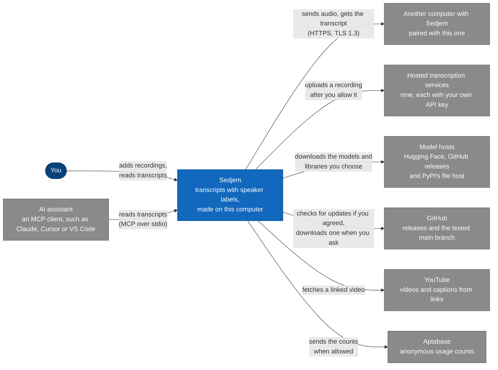
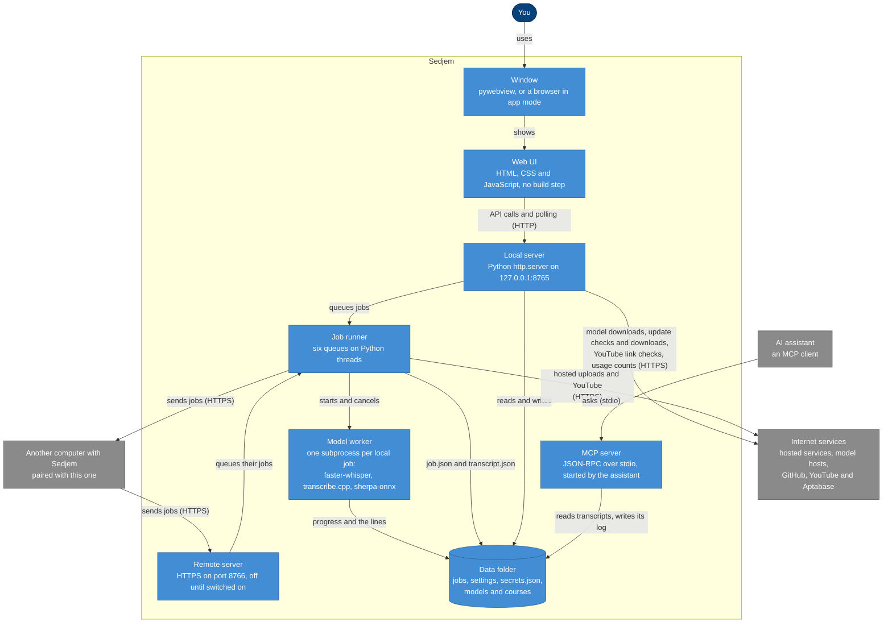
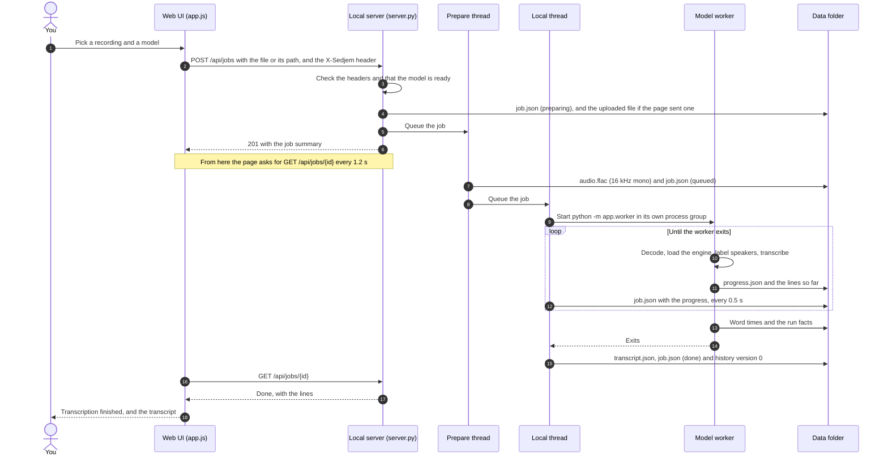

# How Sedjem fits together

Three diagrams of Sedjem on one computer: what it talks to, the parts inside it, and the steps of one local
transcription. They are written in Mermaid, which GitHub shows as pictures. [The app](09-app.md) explains how to use
Sedjem, [the privacy policy](privacy.md) lists everything it contacts, and
[running jobs on another computer](15-remote-runs.md) covers the second server.

## What Sedjem talks to

You work in Sedjem's window. Each arrow gives the main reason for a connection, and the privacy policy gives the
details. An assistant reaches the transcripts through MCP, and a paired computer of yours can run jobs for this one.

## The parts inside Sedjem

Sedjem runs as one Python process: the local server, the job runner's threads, and the threads for model downloads,
updates and usage counts. Each local transcription gets a short-lived worker process, so the models never run in the
app itself, and cancelling a job ends that process. The MCP server is a separate process that the
assistant starts; it reads the data folder directly, so it works while the app is closed.

## One local transcription, step by step

The page sends the recording, and the server answers at once. Threads then prepare the audio and run the worker,
while the page polls for progress; there is no WebSocket. Each step writes its state into the job's folder, so after a
restart, waiting jobs go back on the queue and a job that was running is marked as interrupted.

## Keeping the diagrams current

Change a diagram in the same pull request as a change that adds a part, a queue, a service or a step.
